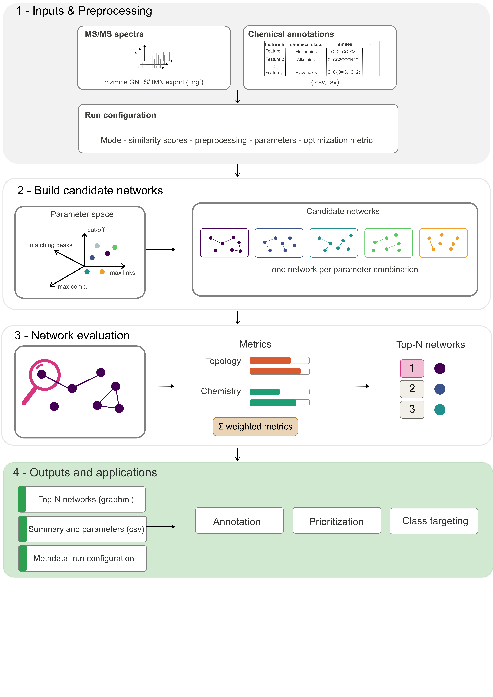

<p align="center">
  
</p>

# arteMIS

[](LICENSE) [](#installation)

**arteMIS** (**A**ccelerated **R**anking and **T**uning using multi-metric **I**nterpretability across **S**cores) helps you build better **molecular networks** from untargeted LC–MS/MS metabolomics data.

Molecular networking connects mass spectra by spectral similarity, but the resulting network depends heavily on the parameters you choose (similarity cut-off, number of links, component size…). Different settings give different networks, and it is rarely obvious which one is "best". arteMIS automates that choice: it **samples many alternative networks**, **scores each one** using complementary network-topology and chemistry criteria, and **ranks** them so you can start downstream analysis from a defensible, well-structured network instead of a single hand-tuned guess.

**Why this helps natural product research.** A good network keeps molecules of the same chemical class together and avoids fragmented or over-connected graphs. arteMIS uses your chemical annotations (from MS2Query or SIRIUS/CANOPUS) to measure how well each candidate network reflects real chemistry, which makes the results easier to interpret for annotation propagation, prioritisation of new chemistry, and class-focused exploration.

---

## Workflow

<p align="center">
  
</p>
<!-- NOTE: docs/images/arteMIS_workflow.png is a provisional draft and still needs
     minor visual polishing (palette, panel backgrounds, label readability). -->

arteMIS runs in four stages:

1. **Inputs & preprocessing.** You provide the **MS/MS spectra** (an MGF file) and a **chemical annotation table** (CSV/TSV). A **run configuration** (mode, similarity score, preprocessing, sampling parameters, optimisation metrics) controls everything else. Spectra are cleaned/harmonised before scoring.
2. **Build candidate networks.** arteMIS explores a **parameter space** with Latin-hypercube sampling and builds **one candidate network per parameter combination**.
3. **Network evaluation & ranking.** Each candidate is scored with **topology** and **chemistry** metrics, combined into a single composite score, and the **top-ranked networks** are selected.
4. **Outputs & applications.** arteMIS writes the **top-ranked networks** (GraphML), a **ranked table of configurations** with their metrics, and **run metadata**. These feed downstream work such as annotation propagation, prioritisation, and class targeting.

The inputs are your data (spectra + annotations); the configuration is *how* arteMIS processes them. The files arteMIS produces (networks, tables, metadata) are distinct from the scientific uses you then make of them.

---

## Installation

arteMIS requires **Python ≥ 3.13**.

```bash
git clone https://github.com/rtlortega/arteMIS.git
cd arteMIS
```

With conda (recommended), using the bundled [`environment.yml`](environment.yml):

```bash
conda env create -f environment.yml
conda activate artemis
```

Or into an existing environment:

```bash
pip install -e .
```

Check that the command-line tool is available:

```bash
artemis --help
```

`artemis` and `artemis-run` are the same command (either works).

---

## Quick start

Run the bundled demo (from the repository root). This uses MS2Query annotations in **global** mode and writes everything to the output directory:

```bash
artemis --mgf demo/input/demo_spectra.mgf \
    --chem demo/input/chem_file/demo_MS2Query.csv \
    --out demo/tests/MS2Query_global
```

- `--mgf` — the MS/MS spectra ([see Inputs](#inputs)).
- `--chem` — the chemical annotation table (here MS2Query results, which already contain SMILES).
- `--out` — the output directory; results are written here ([see Outputs](#outputs)).

Mode defaults to `global`, scores to `modcosine`, and the number of sampled networks to `100`. See [Choosing a mode](#choosing-a-mode) and [Configuration](#configuration) to adapt it, and [Examples](#examples) for seed, target, and SIRIUS runs.

---

## Inputs

arteMIS needs two inputs on the command line: the **spectra** (`--mgf`) and a **chemical annotation table** (`--chem`, with an optional `--smiles` companion for SIRIUS).

### Spectra (`--mgf`) — the MZmine GNPS/IIMN export

arteMIS reads the spectra file exported from **MZmine**: the one named `*_iimn_gnps.mgf` (the IIMN / GNPS export). This is the **only** spectra file the pipeline reads, in **every** mode. In the demo it is [`demo/input/demo_spectra.mgf`](demo/input/demo_spectra.mgf).

> ⚠️ **Do not** pass a SIRIUS-oriented `.mgf` (e.g. `demo/demo_300_sirius.mgf`). That file is produced only to run SIRIUS in parallel and is in a format matchms does not handle here — it is an input *to SIRIUS*, never to arteMIS. The spectra and the SIRIUS annotations are two separate things.

Spectra and annotation rows are linked by a **feature id** shared between the MGF and the annotation table, so the MGF must carry feature ids (the MZmine IIMN/GNPS export does).

### Chemical annotations (`--chem`, optional `--smiles`)

`--chem` is a table (`.csv` or `.tsv`) describing each feature. arteMIS needs three pieces of information per feature:

| Illustrative column | What it means | Actual column name expected |
|---|---|---|
| feature id | links the row to a spectrum in the MGF | `feature_id` (MS2Query) or `mappingFeatureId` (SIRIUS) |
| chemical class | the class label used for the chemistry metrics | set by `--chem-level` (see below) |
| SMILES | the structure, used to compute molecular fingerprints | `smiles` |

*(The first column is illustrative; the third column lists the names arteMIS actually looks for.)*

- **`--chem-level`** selects the class column that drives the chemical optimisation. Default `npc_pathway_results` (MS2Query); use `NPC#pathway` for SIRIUS/CANOPUS. arteMIS prints the column it is using on every run and fails with the list of available columns if the name is not found.
- **SMILES** must be present as a `smiles` column (used for fingerprints). Where it lives depends on the annotation source:

| Source | Class labels | SMILES | How to pass |
|---|---|---|---|
| **MS2Query** | in the results table | in the **same** table | `--chem results.csv` |
| **SIRIUS/CANOPUS** | CANOPUS structure summary | in a **separate** structure-identifications table | `--chem canopus_summary.csv --smiles structure_identifications.csv` |

For SIRIUS, arteMIS merges the two tables on the feature id (`mappingFeatureId`). Both `.csv` and `.tsv` are accepted.

**Required vs optional**

- Required: `--mgf`, `--chem`, `--out`; a feature-id column, a `smiles` column, and the `--chem-level` class column.
- Optional: `--smiles` (only for the SIRIUS two-file case), everything else has a default.

**Troubleshooting inputs**

- *`AttributeError`/empty network, or features not matching* — the MGF is not the MZmine IIMN/GNPS export, or feature ids differ between the MGF and the table.
- *"chem_level column … not found"* — set `--chem-level` to a column that exists (the error lists the available ones).
- *"Feature key not recognized"* — the table has neither `feature_id` nor `mappingFeatureId`.
- *No SMILES / empty fingerprints* — for SIRIUS, remember to pass `--smiles`; the structure table must contain a `smiles` column.

---

## Choosing a mode

arteMIS has three modes. **Global and seed share the same method** (identical metrics and optimisation); they differ only in *intention*. **Target** optimises around one class and uses class-purity metrics instead.

| Mode | `--chem` holds | Scientific purpose | Choose it when | Key arguments |
|---|---|---|---|---|
| **global** (default) | all annotated features | optimise a network over the whole annotated dataset | you have annotations for most features and want the best overall network | *(none; default)* |
| **seed** | a small, high-confidence subset | let only trusted annotations drive the chemistry | you trust only a few annotations and want them as the chemical reference | `--mode seed` |
| **target** | any table with a class column | optimise network structure around one compound class | you want a network focused on a specific class | `--target-class "Class name"` (implies `--mode target`) |

- In **seed** mode, rows whose `--chem-level` value equals `unlabeled_value` (set in `seed.yaml`, default `"No label"`) are dropped before computing chemistry metrics.
- In **target** mode you must name the class with `--target-class`; quote names that contain spaces.

See [Examples](#examples) for a verified-looking command per mode.

---

## Configuration

arteMIS separates **what you run** (command line) from **how the method behaves** (a YAML file).

- **Command line = this run.** Inputs/outputs, mode, and the knobs you commonly change per run: `--scores`, `--tolerance`, `--n-networks`, `--chem-level`, `--target-class`.
- **YAML config = the method.** A per-mode file under [`artemis/configs/`](artemis/configs/) (`global.yaml`, `seed.yaml`, `target.yaml`), loaded automatically for the chosen mode. Pass `--config my_method.yaml` to use a customised copy. Each config holds only preprocessing, the sampling space, and the optimisation metrics.

| Group | Where | Setting | Default | Change it to… |
|---|---|---|---|---|
| Similarity score | CLI | `--scores` | `modcosine` | compute `modcosine` (hybrid matching) and/or `cosine` (fragment matching), comma-separated |
| | CLI | `--tolerance` | `0.02` | widen/narrow the m/z matching tolerance (Da) |
| Preprocessing | YAML | `preprocessing.clean_peaks` | `true` | `false` for harmonising only (no extra cleaning); `true` applies high cleaning |
| Network construction | YAML | `sampling.param_space` | see files | set the ranges explored for `max_comp_size`, `max_links`, `cut_off`, `matching_peaks` |
| Sampling | CLI | `--n-networks` | `100` | sample more/fewer candidate networks |
| | YAML | `sampling.seed` | `27` | change the Latin-hypercube seed (reproducibility) |
| Evaluation | YAML | `optimization.maximize` / `minimize` | mode-specific | choose which metrics are optimised |
| | YAML | `optimization.weights` | `{}` | weight individual metrics, e.g. `{chem_consistency_measurement: 2.0}` |

**Metrics available** (invalid names error at load time):

- **Topology (all modes):** `top_degree_cv`, `top_isolated_nodes`, `top_component_size_gini`
- **Chemistry (global/seed):** `chem_net_avg_intra`, `chem_net_avg_inter`, `chem_consistency_measurement`
- **Chemistry (target):** `chem_edge_purity_target_incident`, `chem_component_purity_target_components`, `chem_target_component_purity`

**How ranking works.** For each score family, every metric is standardised (z-score) across the sampled networks; `maximize` metrics are added and `minimize` metrics subtracted (with optional weights) into a single `composite_score`. The top 10 configurations per score family are written to `top_configs.csv`, and the top 3 networks per family are exported as GraphML.

---

## Outputs

All results are written inside `--out`. For a run with the `modcosine` score family you will find:

| File | Format | Contents | Use it for |
|---|---|---|---|
| `modcosine_top1_graph.graphml` … `_top3_graph.graphml` | GraphML | the 3 best-ranked networks for that score family | open in Cytoscape; downstream analysis |
| `top_configs.csv` | CSV | top 10 configurations per score family: parameters, metrics, `composite_score` | compare/choose configurations |
| `networks.json` | JSON | metrics for **all** sampled candidate networks | full results / custom analysis |
| `LHS.json` | JSON | the sampled parameter sets | inspect the explored parameter space |
| `modcosine-scores.npz` | NPZ (matchms) | pairwise spectral similarity matrix | reuse scores without recomputing |
| `cleaned_spectra.mgf` | MGF | spectra after preprocessing | check preprocessing |
| `run_info.yaml` | YAML | effective parameters + the exact command run | reproducibility |
| `config.yaml` | YAML | a copy of the method config used | reproducibility |

Score-family-specific files (`graphml`, `-scores.npz`) are prefixed with the score name, so running multiple scores produces one set each. The ranked **network** files (GraphML) are what you take forward; `top_configs.csv` and `networks.json` are the **tables** behind the ranking; `run_info.yaml`/`config.yaml` capture **how** the run was done.

---

## Examples

All commands run from the repository root and use the bundled [`demo/`](demo/) data. Every run uses the same spectra file, [`demo/input/demo_spectra.mgf`](demo/input/demo_spectra.mgf) (the MZmine IIMN/GNPS export — see [Inputs](#inputs)).

### MS2Query input

MS2Query puts class predictions **and** SMILES in one table, so only `--chem` is needed.

```bash
# global — use all annotated features
artemis --mgf demo/input/demo_spectra.mgf \
    --chem demo/input/chem_file/demo_MS2Query.csv \
    --out demo/tests/MS2Query_global

# seed — start from the high-confidence subset
artemis --mode seed --mgf demo/input/demo_spectra.mgf \
    --chem demo/input/chem_file/MS2Query_demo_spectra_seed.csv \
    --out demo/tests/MS2Query_seed

# target — build the network around one class (quote multi-word names)
artemis --target-class "Shikimates and Phenylpropanoids" \
    --mgf demo/input/demo_spectra.mgf \
    --chem demo/input/chem_file/demo_MS2Query.csv \
    --out demo/tests/MS2Query_target
```

The seed table (`MS2Query_demo_spectra_seed.csv`) is produced by [`demo/generate_demo_seed_chem_file.ipynb`](demo/generate_demo_seed_chem_file.ipynb), which keeps only the MS2Query rows with `ms2query_model_prediction > 0.7` (294 → 50 features). Seed and global run the *same* method; the seed run just starts from that trusted subset.

### SIRIUS input

SIRIUS splits class predictions (CANOPUS summary) from SMILES (structure identifications), so pass both files and set `--chem-level` to the CANOPUS column:

```bash
artemis --mgf demo/input/demo_spectra.mgf \
    --chem demo/input/chem_file/demo_SIRIUS_canopus_structure_summary.csv \
    --smiles demo/input/chem_file/demo_SIRIUS_structure_identifications.csv \
    --chem-level "NPC#pathway" \
    --out demo/tests/SIRIUS_global
```

`.tsv` versions of the SIRIUS tables sit in the same folder and work too (swap the `.csv` paths for their `.tsv` counterparts).

### Advanced

```bash
# two score families, wider tolerance, fewer networks
artemis --mgf demo/input/demo_spectra.mgf \
    --chem demo/input/chem_file/demo_MS2Query.csv \
    --out demo/tests/MS2Query_multi \
    --scores modcosine,cosine --tolerance 0.05 --n-networks 50

# custom method file
artemis --mgf ... --chem ... --out ... --config my_method.yaml
```

---

## Attribution

### License

The code in this package is licensed under the [MIT License](LICENSE).

### Citation

Laura Rosina Torres-Ortega, Esteban Charria-Girón, Florian Huber, Matteo Simone, Margherita Sosio, Justin J.J. van der Hooft
bioRxiv 2026.08.17.745252; doi: https://doi.org/10.64898/2026.08.17.745252

### Contact

Please open a GitHub Issue for bugs/feature requests.

Maintainers: Rosina Torres-Ortega ([rosina.torresortega@wur.nl](mailto:rosina.torresortega@wur.nl)) and Esteban Charria-Girón ([esteban.charriagiron@wur.nl](mailto:esteban.charriagiron@wur.nl))
